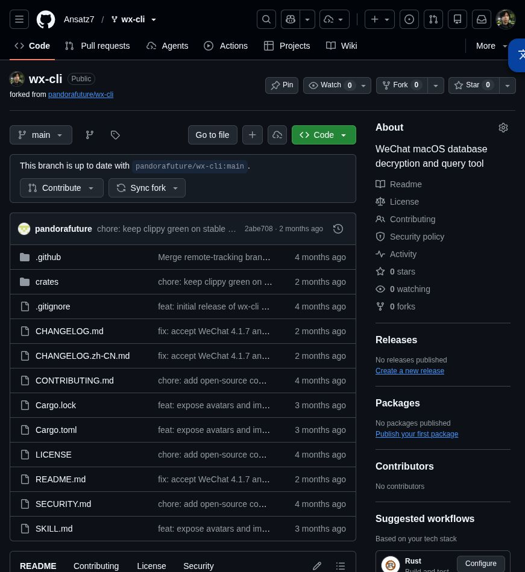

# wx-cli：Linux / Omarchy 4.0 移植可行性评估

评估日期：2026-10-18  
上游：[pandorafuture/wx-cli](https://github.com/pandorafuture/wx-cli)  
Fork：[Ansatz7/wx-cli](https://github.com/Ansatz7/wx-cli)  
基线：`2abe708f55bfe135539a385df856fdc58f97fc74`，工作区版本 0.7.4  
评估分支：`assessment/linux-omarchy`

## 结论

**可以推进 Linux 移植；无需 Rust 重写，因为项目本身已经是 Rust。**

推荐保留现有八个 crate，在平台边界补充 Linux 实现，第一目标设为 **Omarchy 4.0 / x86_64 / 原生 Linux 微信**。当前结果支持“已有可编译的 Linux 基础”，还不能支持“已适配 Linux 微信并可直接投入使用”。

本次已完成 fork、云端克隆、源码审查、Linux 基线构建和核心测试。分支只增加评估材料，未修改业务源码、未实现 Linux 密钥提取，也未读取任何真实微信账号。

## 1. 已验证的事实

### 项目已经是 Rust

根目录 `Cargo.toml` 定义八个成员：

| crate | 现有职责 | 移植判断 |
|---|---|---|
| wx-cli | CLI、REST API、SSE、服务管理 | 大部分可复用，检查与平台提示需要修改 |
| wx-context | 账号解析、解密缓存、查询上下文 | 可复用框架，需接入 Linux 账号发现和格式识别 |
| wx-db | SQLite/SQLCipher、会话/联系人/消息查询 | 可复用，必须验证 Linux schema 和消息编码 |
| wx-decrypt | KDF、AES/HMAC、数据库与 WAL 解密 | 可复用算法，参数不能仅凭版本号假定兼容 |
| wx-keychain | 密钥捕获、账号发现、存储 | 主要平台改造点 |
| wx-media | 图片/音频/视频解析 | 条件复用，需 Linux 媒体样本和构建依赖 |
| wx-monitor | 文件变化监控、增量读取 | 已有非 macOS notify 分支，需真实 WAL 验证 |
| wx-paths | 配置、缓存、状态路径 | 已有 Linux/XDG 实现，微信自身路径是另一回事 |

基线包含 155 个 Rust 文件、43,513 行，包括测试；这些统计不等同于生产代码量，也不能直接推导工作量。全量重写会重复已有解析、缓存、WAL 和测试工作。

### Linux 云端验证

环境：Ubuntu 24.04.3 LTS，`x86_64-unknown-linux-gnu`，Rust/Cargo 1.99.1。**这不是 Omarchy 实机验证。**

| 验证 | 结果 |
|---|---|
| `cargo build --locked -p wx-cli --no-default-features` | 通过，生成 Linux CLI |
| `cargo test --locked -p wx-paths -p wx-decrypt -p wx-keychain` | 125 项测试通过，0 失败 |
| 默认 audio 构建 | 补齐 libclang 和标准 C 头文件搜索路径后通过（包含默认 audio/SILK 功能） |
| `wx-cli --version` | 成功，输出 0.7.4 和基线提交 |
| `wx-cli paths` | 成功，识别 linux 并输出 XDG 路径 |
| `wx-cli doctor` | 仍检查 csrutil、DevToolsSecurity、_developer、LLDB；不能作为 Linux 健康检查 |
| `wx-cli key scan` | 返回错误：key scan is only supported on macOS |
| 真实 Linux 微信的密钥、聊天、媒体、实时监听 | 未验证，云端没有该客户端与账号数据 |
| Omarchy 4.0 实机、ARM64、Flatpak/Wine | 未验证 |

首次 `cargo check --workspace --all-targets --locked` 在 `silk-rs` 的 bindgen 步骤因缺少 libclang 失败，属于构建环境缺依赖。随后将 libclang 18.1.1 安装到临时目录，并为 bindgen 指定已有 GCC 标准头文件路径，默认 audio 构建通过。此次环境的临时构建命令是：

```bash
LIBCLANG_PATH=/tmp/wx-libclang/clang/native \
BINDGEN_EXTRA_CLANG_ARGS='-isystem /usr/lib/gcc/x86_64-linux-gnu/13/include' \
cargo build --locked -p wx-cli
```

这些路径只记录本次验证环境，不应硬编码进项目或作为 Omarchy 安装命令。

现有代码在 Linux 产生少量 unused import/variable/dead code 警告。上游只在 macOS 运行 CI，因此移植时应添加 Linux job 并消除这些警告，尤其是启用 `-D warnings` 时。本次未执行完整 workspace 测试套件。

## 2. 真正需要改造的位置

### 2.1 密钥捕获：最关键，按微信构建与架构划分后端

代码证据：

- `crates/wx-keychain/src/script.rs`：LLDB hook 的目标为 Apple `CCKeyDerivationPBKDF`，读取 ARM64 的 `x1..x6` 寄存器。
- `crates/wx-keychain/src/lldb.rs`：调用 `killall WeChat`、`open -a WeChat`，等待 macOS 进程。
- `crates/wx-keychain/src/mach_vm/mach_reader.rs`：使用 `mach2`、`task_for_pid` 和 Mach VM API。
- `crates/wx-cli/src/cmd/key.rs`：非 macOS 的 `cmd_key_scan` 是明确的不支持分支。
- `crates/wx-keychain/src/mach_vm/reader.rs` 已有 `MemoryReader` trait；模式识别和 HMAC 验证与底层读取已部分分离。

建议形成三个入口：

1. **手动导入密钥**：作为首个端到端验证入口。区分原始 32 字节材料和按 salt 保存的派生密钥；不能把任意 enc_key 当成 RawKey 再做 PBKDF2。
2. **Linux 进程内存扫描**：为已验证仍缓存密钥字面量的构建实现 `MemoryReader`；使用 Linux 的进程映射与读取接口，复用候选匹配、salt 关联、HMAC 验证。
3. **Linux 登录时捕获**：对于不再保留旧缓存模式的构建，需要独立的 ELF/ABI/调试后端，捕获 WCDB 配置密钥的调用。不能只把 Mach API 换成 /proc 就宣称覆盖新版。

Linux 参考项目 `boujuan/extract-wechat-messages-linux` 的 `passphrase.py` 实现了 x86_64 的 ELF 定位和 ptrace 捕获，源码注明算法对 4.1.13.9 验证过。README 对“≥4.1”和“4.1.13+”的描述不完全一致，因此本评估只把它视为**存在可参考实现**，不据此保证某个版本范围全部可用。动态定位仍可能随微信更新失效。

权限方面应报告实际访问错误、UID、目标进程和 Yama 限制。Linux 的读取能力与进程关系、dumpable、capability、LSM/容器策略相关，不是“同用户必然成功”，也不是“总是必须 root”。常驻查询服务应保持普通用户权限；不要将永久关闭系统限制作为默认安装流程。

### 2.2 微信路径与进程发现

`wx-paths/src/platform.rs` 已经支持 Linux 的配置/缓存/状态目录，但 `wx-keychain/src/process.rs` 仍：

- 硬编码 `~/Library/Containers/com.tencent.xinWeChat/Data/Documents/xwechat_files`；
- 用 `pgrep -x WeChat`；
- 用 `defaults read /Applications/WeChat.app/Contents/Info.plist` 读取版本；
- 使用 macOS 的最低提取版本规则。

Linux 后端应优先尊重显式配置，再尝试有限、可解释的候选路径。参考实现中的候选包括：

- `~/.local/share/WeChat_Data/xwechat_files/`
- `~/Documents/xwechat_files/`

它们只是候选，不是所有安装方式的保证。还要考虑 XDG 自定义目录、多账号、账号目录后缀和用户更改存储位置。保留当前 `--data-dir` 显式指定能力作为最可靠的逃生口，不应要求用户把 Linux 数据复制到伪造的 macOS 目录。

进程识别应结合 UID、可执行文件、进程名与明确 PID，避免模糊匹配到命令行中含“wechat”的解释器。首版聚焦原生安装；Flatpak、Wine、容器分别记录支持状态。

### 2.3 加密参数和表结构

`wx-decrypt/src/params.rs` 目前只有名为 `MACOS_4_1_7_31` 的 profile，参数为 4096 字节页、256,000 次 PBKDF2、SHA-512 HMAC、80 字节保留区；`wx-db/src/open.rs` 等位置直接引用它。

这些数值与公开 Linux 参考实现描述相近，**相近不等于目标数据库已经验证兼容**。应：

- 从目标客户端样本确认页参数并验证 HMAC；
- 验证解密后 SQLite 完整性；
- 检查 `SessionTable`、`Msg_*`、联系人表、压缩字段和群聊发送者映射；
- 将 crypto profile / schema profile 与已验证客户端构建关联；
- 对未知 schema 明确报错或降级，不能返回看似完整的空数据；
- 处理多个数据库 salt、新增分片和登录后的 re-key。

可先采用已知 profile + 明确 opt-in 的实验模式，验证后再声明支持。

### 2.4 监控、服务与媒体

`wx-monitor/src/monitor.rs` 的 Auto 模式在非 macOS 走 notify，`watcher.rs` 同时保留轮询实现。需要在 Linux 微信真实写入下验证 WAL 写入、checkpoint、数据库替换、多消息同秒和断线重连，不能把“收到文件事件”视作“完整实时消息流”。

现有 HTTP/SSE 主要依赖 Tokio/Axum，平台可复用程度较高。首版沿用 loopback 默认地址。服务管理已有自己的子进程机制：若添加 systemd 用户单元，应提供明确前台模式，避免让 systemd 的简单服务类型误判自后台化进程。

媒体模块包含 SILK 的原生编译和 ffmpeg 子进程。Linux 打包需声明相应构建/运行依赖；先验收文本，再逐步验收图片、语音、视频。图片密钥与数据库密钥应分别验证。

### 2.5 与移植直接相关的存储问题

`wx-keychain/src/store.rs::save` 使用临时 TOML 文件再 rename，但当前没有显式强制 0600；实际权限受 umask 等影响。密钥命令还可能将密钥打印到 stdout。

Linux 版本应在创建时就设置文件权限、限制目录权限、避免将密钥写入普通日志，并测试原子写入、符号链接和并发情形。普通账户查询与一次性密钥获取应分开。这些是具体源码带来的改造项，不代表已执行安全审计或已修复。

## 3. Omarchy 4.0 适配判断

Omarchy 4.0 官方发布说明确认 Hyprland 配置、Quickshell 桌面以及 Arch/pacman 包管理改造。

**wx-cli 的数据读取路径没有依赖屏幕坐标、键盘模拟、X11 或 Wayland 协议。** 因此，基于其架构推断，桌面合成器不是主要移植障碍；微信的存储、进程权限与密钥行为才是关键。

建议的发行目标：

| 项目 | 第一阶段选择 |
|---|---|
| 架构 | x86_64 Linux GNU |
| 客户端 | 原生 Linux 微信，记录精确版本/构建及安装来源 |
| Omarchy 集成 | 普通 CLI + 可选 systemd 用户服务 |
| 打包 | Linux tarball；验证后再提供 PKGBUILD |
| 构建依赖 | Rust、C/C++ 编译器；音频构建需要 libclang；确认 SQLCipher/OpenSSL 链接方式 |
| 运行依赖 | 按产物实际链接声明；媒体转换需要 ffmpeg |
| ARM64 | 后续独立验收，不沿用 x86_64 寄存器/指令假设 |

Ubuntu 的构建成功不能代替 Arch/Omarchy 验收。发布前需要 Omarchy 干净环境的构建/安装测试及动态库检查。不要为适配 CLI 改动用户的 Hyprland 或输入设备设置。

## 4. 推荐实施顺序及验收门槛

| 阶段 | 工作 | 完成条件 |
|---|---|---|
| A：Linux 基础适配 | 平台分发、doctor、路径/进程识别、Linux CI | 明确区分可用/不可用功能；CI 编译通过；不再给出 macOS 修复命令 |
| B：已有密钥的文本闭环 | 显式目录、密钥导入、crypto/schema 样本 | 指定 Linux 测试库通过 HMAC、完整性检查，联系人/会话/消息对得上 |
| C：原生密钥获取 | 先支持一个精确构建与 x86_64；按结果选择扫描或登录捕获 | 只读取指定账号进程；候选密钥验证成功；失败时可诊断、可恢复 |
| D：实时与媒体 | WAL/notify、SSE、图片/音频/视频 | 消息去重/续传可验证，媒体与微信显示相符 |
| E：Omarchy 发布 | Arch 构建、依赖、用户服务、安装文档 | Omarchy 4.0 新环境可复现安装、启动、重启与卸载 |

**优先投入 A、B；C 决定能否成为“安装即用”的工具。** 如果只需要导入已有数据库，B 可以提供有限价值；如果需要持续读取本机微信，必须完成 C、D。

建议保留平台无关的解析/解密核心，将平台差异收敛为 PlatformDiscovery、KeyProvider 和 Crypto/SchemaProfile 等接口。已有 MemoryReader 可以继续使用，不必为了抽象先重构整个仓库。

## 5. 云端开发与最终运行的位置

当前云端适合编译、合成数据库测试和维护代码。运行时需要访问**装有并登录微信的那台机器**的数据目录及必要的进程；单纯把源码放到云端不会获得本地聊天记录。

首选部署方式是 Omarchy 本地运行 wx-cli，云端 Agent 如有需求再通过受控连接访问本地服务。若明确要在云端长期运行微信，则是额外的桌面会话、登录、数据持久化和进程权限项目，不在此次评估已验证范围内。

本项目目前提供读取、搜索、导出与订阅能力；发送消息、发朋友圈和界面操作需要独立能力，不应纳入此次移植默认承诺。

## 6. 下一步需要的目标环境信息

进入真实客户端适配前确认：

1. Omarchy 具体小版本与 CPU 架构。
2. 微信精确版本，以及原生包、AUR、AppImage、Flatpak 或 Wine 哪一种安装方式。
3. 首批目标是“文本查询/导出”还是“持续实时订阅”。

这些信息用于选择后端和构建验收矩阵；不需要把私人聊天数据库或密钥提交到 GitHub。可在目标机器上运行验证，仅提供去敏后的诊断结果。

## 参考与证据

- [本次上游基线](https://github.com/pandorafuture/wx-cli/tree/2abe708f55bfe135539a385df856fdc58f97fc74)：本报告中路径均对应此提交。
- [Cargo 工作区](https://github.com/pandorafuture/wx-cli/blob/2abe708f55bfe135539a385df856fdc58f97fc74/Cargo.toml)。
- [Omarchy v4.0.0 官方发布说明](https://github.com/omacom/omarchy/releases/tag/v4.0.0)。
- [Linux 参考项目](https://github.com/boujuan/extract-wechat-messages-linux)，其中 [路径发现](https://github.com/boujuan/extract-wechat-messages-linux/blob/main/src/wxextract/discover.py) 与 [登录捕获](https://github.com/boujuan/extract-wechat-messages-linux/blob/main/src/wxextract/passphrase.py) 为直接源码证据；本次未执行参考项目。
- [另一 Linux 扫描实现](https://github.com/sbgayhub/wechat-decrypt/blob/main/find_all_keys_linux.py)：仅作机制比较，未复制其代码。
- [Linux 内核 Yama 文档](https://docs.kernel.org/admin-guide/LSM/Yama.html)：进程调试访问限制。
- [Tencent WCDB](https://github.com/Tencent/wcdb)：数据库框架背景；其跨平台属性不能单独证明微信客户端 schema 相同。
- 参考项目的 MIT 许可和 NOTICE 已查看；若后续复用实际代码，应保留相应声明。本次只提交独立评估，没有引入第三方实现。

### Fork 完成截图


